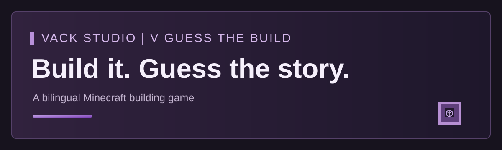

  

# V Guess the Build | Vack Studio

A timed Minecraft building and guessing game for manually configured arenas. Version **1.6.1**.

## Features

- Six arenas positioned by the server owner in an existing world. No prebuilt map or world is included.
- Capacity queues for 4, 6, 8, and 16 players by default. The configured 75% thresholds start those queues at 3, 5, 6, and 12 players.
- Bilingual English and Arabic topics, messages, and persistent language selection per player.
- Builder turns, guesses, hints, scoring, rewards, and cosmetic preferences.
- Saved player inventory and state are restored after leaving or reconnecting.
- Waiting music can loop through the optional VMusic integration. Native audio remains available when that provider is absent.

## Requirements and setup

The Java plugin targets **Minecraft Paper 26.2** and **Java 25**. Set the waiting, lobby, game, and spectator points for each arena with `/gb setwaiting <arena>`, `/gb setlobby <arena>`, `/gb setgame <arena>`, and `/gb setspectator <arena>`. Administrative setup requires `gb.admin`.

Players may use `/gb game 4`, `/gb game 8`, `/gb game 16`, or `/gb game 4 2` to select a capacity and optionally arena 2. `/gb language` offers English and العربية. VMusic 1.6.0 supplies the optional original NBS waiting track. VHeads 1.0.1 can be used for optional head management.

## Verification

Version 1.6.1 passed 18 Java tests. An isolated VackMini 26.2 startup with an existing `game.min-players: 1` setting verified that a backup was made, the value migrated to 2, both V Guess the Build and VMusic enabled, and `/gb audio` responded. This startup check did not include a connected player or the owner's full server plugin collection. Earlier 1.6.0 gameplay checks do not constitute a full 1.6.1 client test. Leaf, Folia, and Bedrock compatibility has not been verified here.

## Availability

This public repository introduces the game. It contains no source code, plugin JAR, map, or download release. The compiled files are supplied privately by the project owner.

## العربية

**V Guess the Build** لعبة بناء وتخمين من **Vack Studio**. إصدار **1.6.1** يدعم ست ساحات تحدد مواقعها بنفسك في عالم السيرفر، وصفوف انتظار بسعات 4 و6 و8 و16 لاعبًا. لا يوجد ماب جاهز في المشروع.

لإعداد الساحة نفّذ `/gb setwaiting 1` و`/gb setlobby 1` و`/gb setgame 1` و`/gb setspectator 1` وأنت واقف في الموقع المناسب لكل أمر. يدخل اللاعب مثلًا بـ`/gb game 4`، ويختار لغته بـ`/gb language` أو `/gb language ar`. تحتاج الإضافة Paper 26.2 وJava 25، وتعمل موسيقى الانتظار مع VMusic الاختيارية.

التحقق من 1.6.1 شمل 18 اختبار Java وتشغيلًا تجريبيًا مع إعداد قديم كان يوقف الإضافة. لم تشمل التجربة لاعبًا متصلًا أو إضافات سيرفرك كاملة. هذه الصفحة للتعريف فقط؛ ملفات الإضافة والمصدر ليست منشورة للتنزيل هنا.

## Credits and rights

Developed by Vack Studio. Third-party components retain their own licenses and rights.

Copyright (c) Vack Studio. All rights reserved.
